# 🥗 Diet Assistant

⭐ Final Year IT Project | AI/ML | Flask | PostgreSQL | MongoDB

## 📌 Overview

Diet Assistant is an intelligent nutrition recommendation system designed to help users make healthier food choices based on their personal information and fitness goals.

The application analyzes user inputs such as age, weight, height, activity level, and dietary preferences to generate personalized diet recommendations and workout plans.

> Note: This repository serves as a public showcase of the project. The complete source code is maintained in a private repository.

---

## 🚀 Project Workflow

1. User Registration/ Login

2. User health profile creation in which user is asked to enter dietary prferences, cuisines, medical condition (if any then mandatory acknowledgement), calculates BMI, BMR, and TDEE based on user's input.

3. Conversation with the chatbot (Provides diet plans and workout plans based on user health profile data).

4. Option to update profile

5. Logout

---

## 🛠️ Tech Stack

1. Programming & Backend Framework 
    - Python 3.10.20 
    - Flask 
    - Jinja2 

2. Artificial Intelligence & RAG Pipeline 
    - ChatGroq (Groq LPU™ Inference Engine with model openai/gpt-oss-20b)  
    - LangChain 
    - ChromaDB 
    - HuggingFace Embeddings 

3. Database & Polyglot Storage Architecture 
- Relational Database (RDBMS) — PostgreSQL: 
    - Engine: PostgreSQL 
    - ORM: Flask-SQLAlchemy (Object-Relational Mapping for structured relational models). 
- Document Database (NoSQL) — MongoDB: 
    - Driver: PyMongo (MongoClient) 
    - Database: DietMate_DB
 
4. Security & Authentication 
    - Flask-Bcrypt 
    - Python functools.wraps 
    - Audit Logging 

5. Frontend Technologies 
    - HTML5 
    - CSS3 
    - JavaScript & jQuery 3.5.1 
    - Bootstrap 4.5.2 
    - Google Fonts

6. Data Parsing & Utilities 
    - Markdown & MarkupSafe: 
    - markdown (Python) 
    - markupsafe.Markup 
    - Python dotenv (python-dotenv) 
    - Python threading & webbrowser

---

## 🏗️ System Architecture

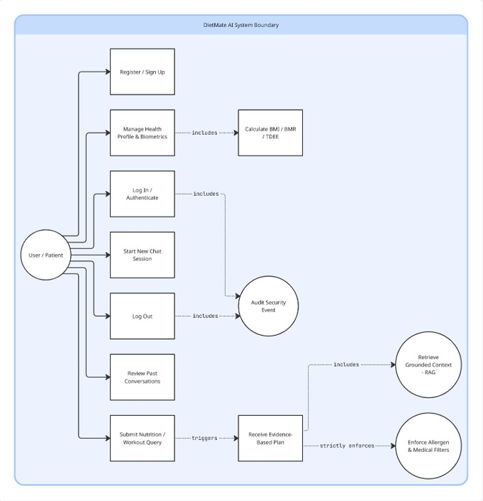

---

## 🗄️ Database Design

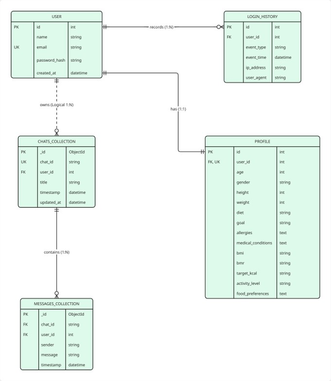

---

## 📸 Application Screenshots

### Login Page
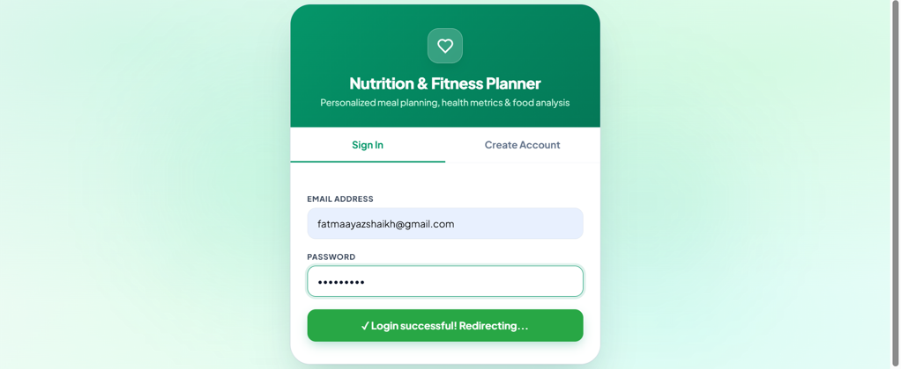

### User Health Profile
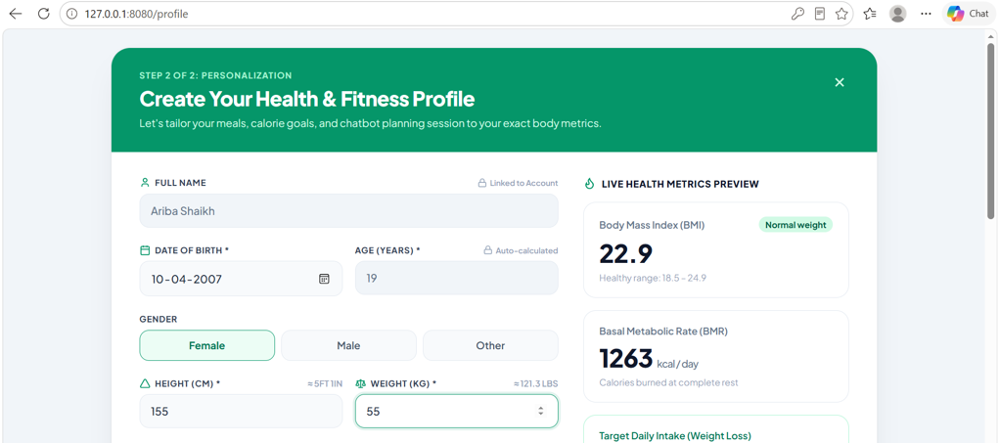
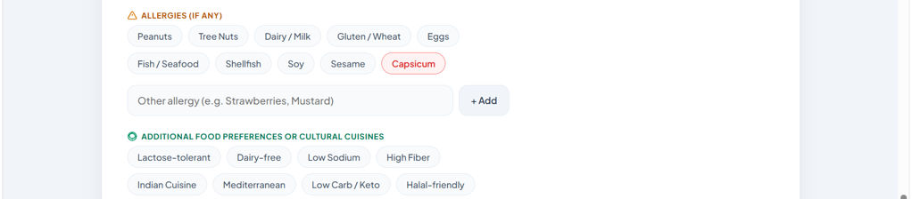
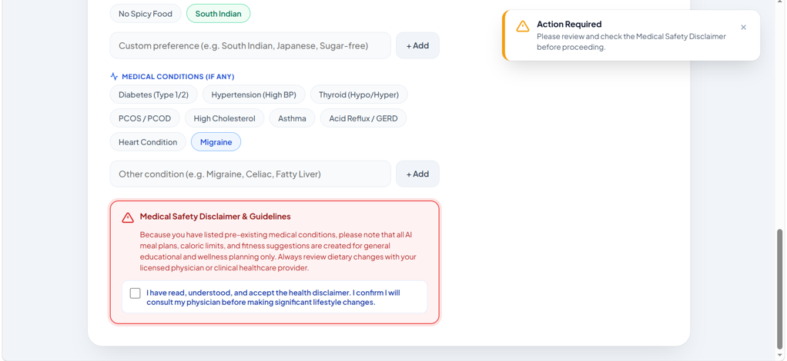
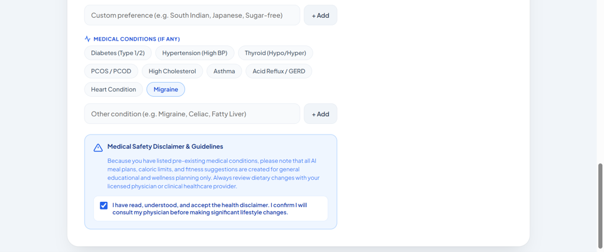

### Chatbot Page
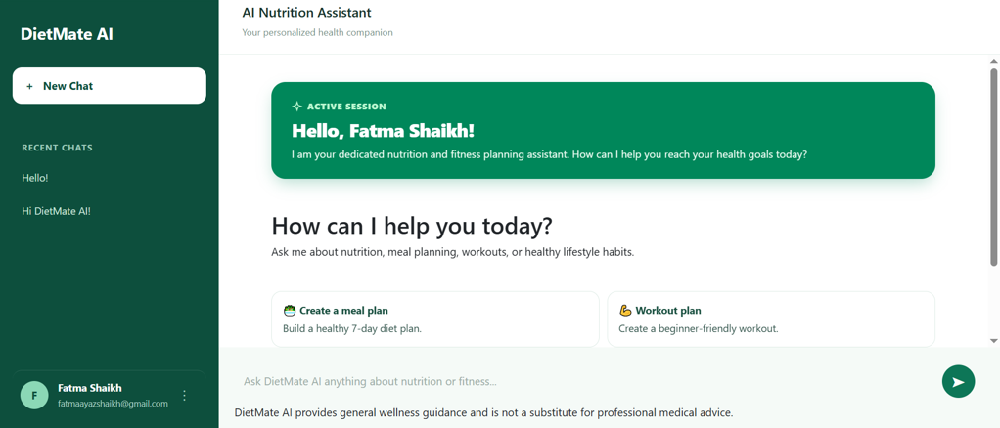
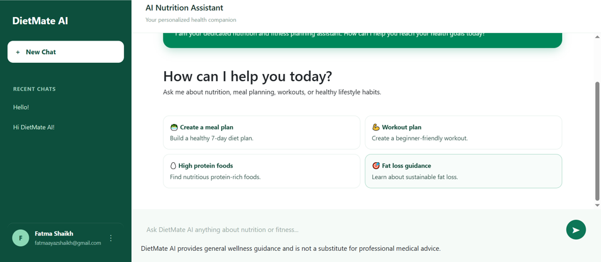

### Diet Recommendation
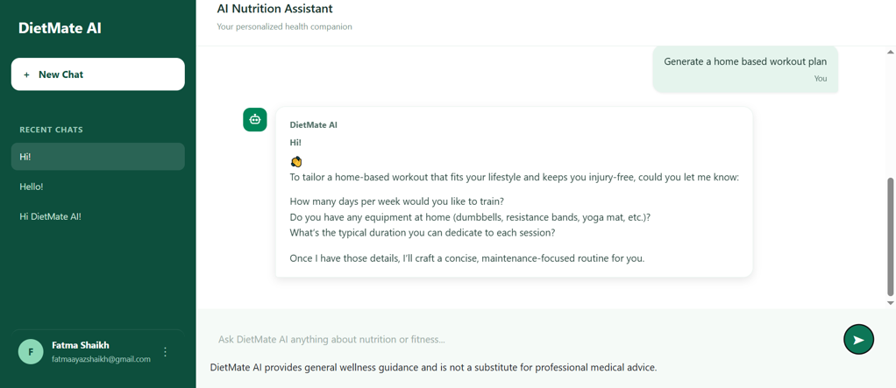
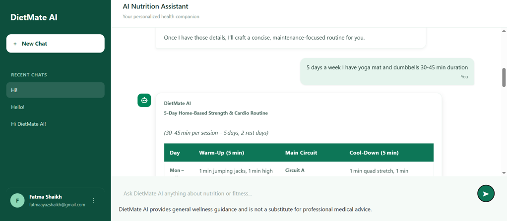

### Options
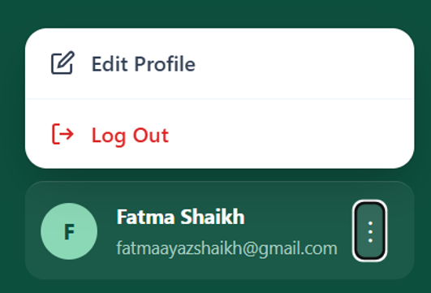

---

## 🎯 Project Highlights

- Developed a full-stack diet recommendation application.
- Implemented personalized nutrition suggestions based on user profiles.
- Integrated PostgreSQL for secure and efficient data storage.

---

## 📈 Future Enhancements

- Integration with fitness trackers and smart wearables.
- Food image recognition for calorie estimation.
- Real-time health analytics and reporting.

---

## 👨‍💻 Author

**Ariba Shaikh**

Final-Year IT Student

---

## 🔒 Source Code

The complete implementation is maintained in a private repository.

A video is available in docs folder showcasing project features.

This repository is intended for project demonstration and portfolio purposes. Additional details can be shared for academic, recruitment, or professional review upon request.
